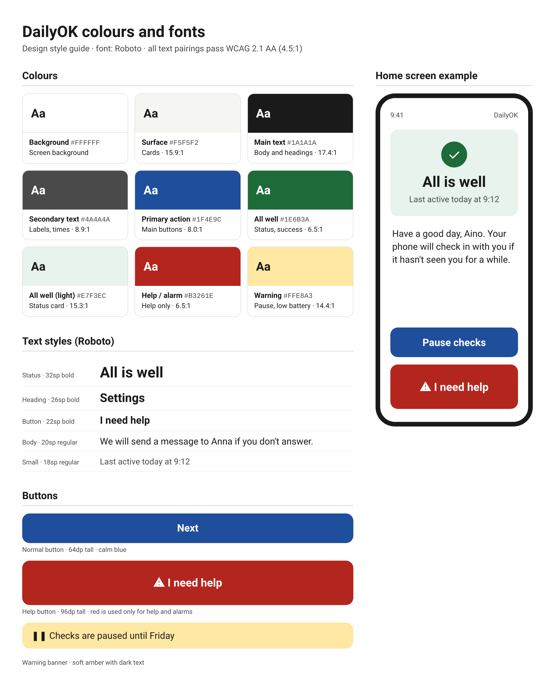

# android-app-project
[View Trello Board](https://trello.com/b/2uEvflKy/title-here)
## Design

DailyOK is designed for older adults, so every screen is built to be **large, high-contrast and simple**. The full rules are in the [Design Style Guide](https://claude.ai/artifact/YZ25mm5DESvsZp74hiRKnB).

### Principles
- One message and at most two actions per screen
- Large text and buttons, single-tap actions only (no swipes or long presses)
- Colour is never the only signal: every state also has a word and an icon
- Red is reserved for "I need help" and alarms

### Colours
| Role | Hex | Use |
| --- | --- | --- |
| Main text | `#1A1A1A` | Body text and headings |
| Secondary text | `#4A4A4A` | Labels and times |
| Primary action | `#1F4E9C` | Main buttons |
| All well | `#1E6B3A` / `#E7F3EC` | Status and success |
| Help / alarm | `#B3261E` | Help button and alarm only |
| Warning | `#FFE8A3` | Paused checks, low battery |

All text pairings meet WCAG 2.1 AA contrast (4.5:1 or higher).

### Typography
Roboto (Android default), sized in `sp` so it scales with the system font setting:
Status 32sp bold · Heading 26sp bold · Button 22sp bold · Body 20sp · Small 18sp (minimum).

### Sizes
Buttons are at least 64dp tall (96dp for "I need help"), with 16dp between touch targets, 24dp screen margins and 16dp rounded corners.

### In code
The theme lives in `ui/theme/`. Wrap screens in `DailyOkTheme { … }` and use the shared components (`DailyOkButton`, `HelpButton`, `StatusCard`, `WarningBanner`) instead of styling elements by hand.
