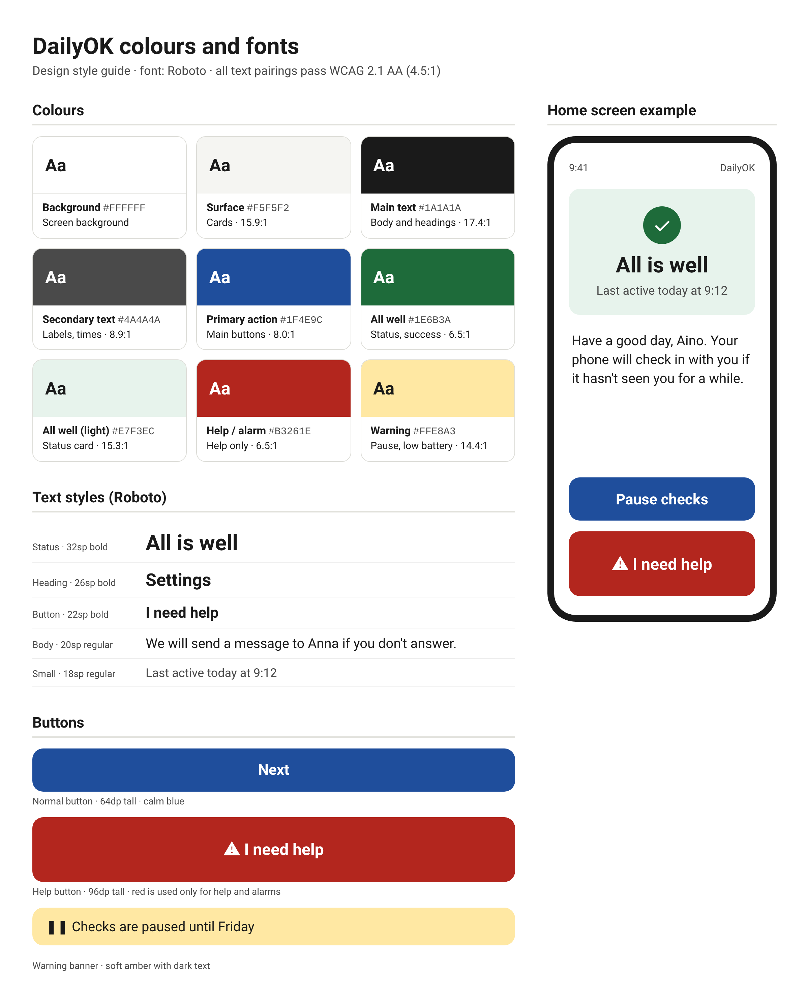

# android-app-project
[View Trello Board](https://trello.com/b/2uEvflKy/title-here)
## Design

### Principles
- One message and at most two actions per screen
- Large text and buttons, single-tap actions only (no swipes or long presses)
- Colour is never the only signal: every state also has a word and an icon
- Red is reserved for "I need help" and alarms

### Colours
| Role | Hex | Use |
| --- | --- | --- |
| Main text | `#1A1A1A` | Body text and headings |
| Secondary text | `#4A4A4A` | Labels and times |
| Primary action | `#1F4E9C` | Main buttons |
| All well | `#1E6B3A` / `#E7F3EC` | Status and success |
| Help / alarm | `#B3261E` | Help button and alarm only |
| Warning | `#FFE8A3` | Paused checks, low battery |

All text pairings meet WCAG 2.1 AA contrast (4.5:1 or higher).

### Typography
Roboto (Android default), sized in `sp` so it scales with the system font setting:
Status 32sp bold · Heading 26sp bold · Button 22sp bold · Body 20sp · Small 18sp (minimum).

### Sizes
Buttons are at least 64dp tall (96dp for "I need help"), with 16dp between touch targets, 24dp screen margins and 16dp rounded corners.

### In code
The theme lives in `ui/theme/`. Wrap screens in `DailyOkTheme { … }` and use the shared components (`DailyOkButton`, `HelpButton`, `StatusCard`, `WarningBanner`) instead of styling elements by hand.

## Daily checks

DailyOK checks on the person twice a day and starts the "Are you OK?" flow (prompt → alarm → SMS) when it sees no signs of normal life.

| Check | Rule (defaults) |
| --- | --- |
| Morning check | No activity since waking (07:00) by the morning check time (10:00) → prompt |
| Daytime check | No activity for the inactivity period (4 h, adjustable 2–6 h) between waking and bedtime (22:00) → prompt |

- Sleep time never counts as inactivity, and nothing runs after bedtime.
- The home screen's pause switch turns all checks off.
- After a prompt, there is no new prompt until the person is active again.
- **Activity** = unlocking the phone, unplugging the charger, or pressing "I'm OK" (on the home screen or the prompt).

### How it works

| File | Role |
| --- | --- |
| `domain/CheckEngine.kt` | The rules as a pure Kotlin function: `evaluate()` returns `AllWell` or `Prompt(reason)`, `nextCheckTime()` says when to look again. No Android code. |
| `data/CheckStore.kt` | Saves last activity, last prompt and check times on the phone (`app_prefs`, shared with the home screen). |
| `platform/check/CheckScheduler.kt` | Sets an alarm for the next check; when it fires, runs the engine and starts the prompt. |
| `platform/check/CheckAlarmReceiver.kt` | Receives the alarm, works with the screen off and the app closed. |
| `platform/check/ActivityTracker.kt` | Records activity and moves the next check. |
| `platform/check/CheckNotifier.kt` | Full-screen "Are you OK?" notification when the app is closed. |
| `platform/check/CheckService.kt` | Foreground service that keeps activity tracking and check scheduling alive in the background. |
| `platform/check/BootReceiver.kt` | Restarts background service and reschedules check alarms after device restarts (`BOOT_COMPLETED`). |

Tests: `app/src/test/.../domain/CheckEngineTest.kt` covers a normal day, a lie-in, a nap, sleep hours, pause and demo inactivity periods. Run it from Android Studio.

**Permissions:** notifications (asked on first start), full-screen intent, exact alarms, boot completed, foreground service. On Android 14 exact alarms are off by default, so a check can fire a few minutes late unless *Alarms & reminders* is allowed for the app.

## Demo settings

*Settings → Demo* holds mock values for presentations; changes apply at once and are saved on the phone.

| Setting | Range (default) |
| --- | --- |
| Demo mode | On / off (on). Off = real timings: prompt 10 min, alarm 15 min |
| Prompt waits before alarm | 5–120 s (15 s) |
| Alarm countdown before SMS | 10–300 s (30 s) |
| Inactivity period (daytime check) | Normal, 30 s, 1, 2, 5, 10, 30 or 60 min (Normal = the 2–6 h setting) |

Buttons: **Simulate a missed morning**, **Simulate inactivity** (pick a short inactivity period first), **Run the check now**, and **Reset check times to normal** (use after simulating a missed morning). A status panel shows the check times, last activity, last prompt and next check.

Hidden trigger: when demo mode is on, long-press the top-right corner of any screen to start the prompt or the alarm.

Before real users get the app, turn demo mode off or remove `demoSection = { DemoSection() }` from `SettingsRoute`.
